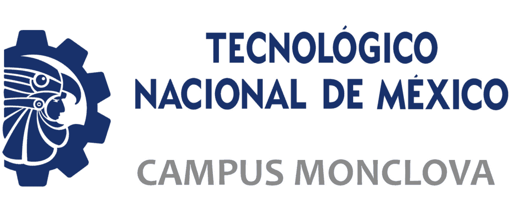
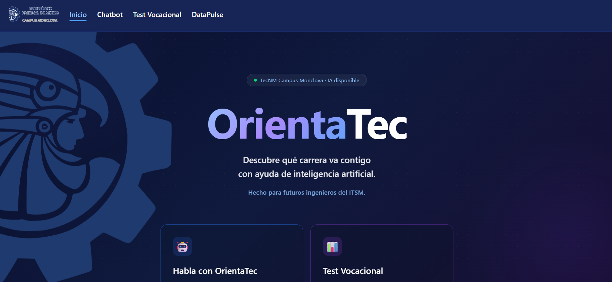
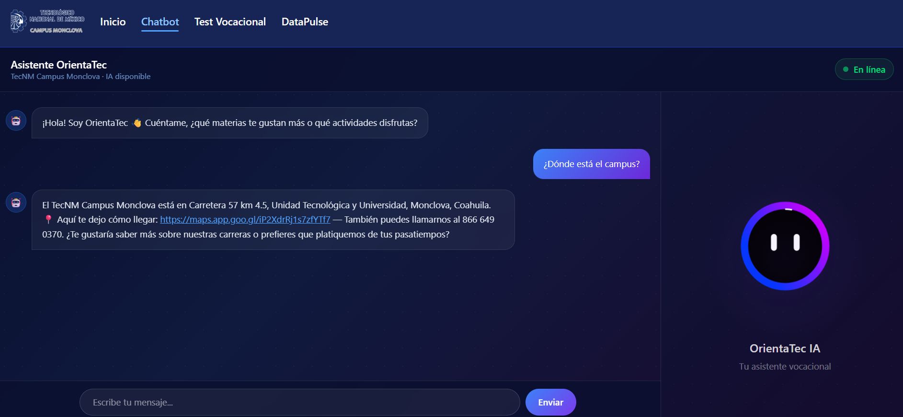
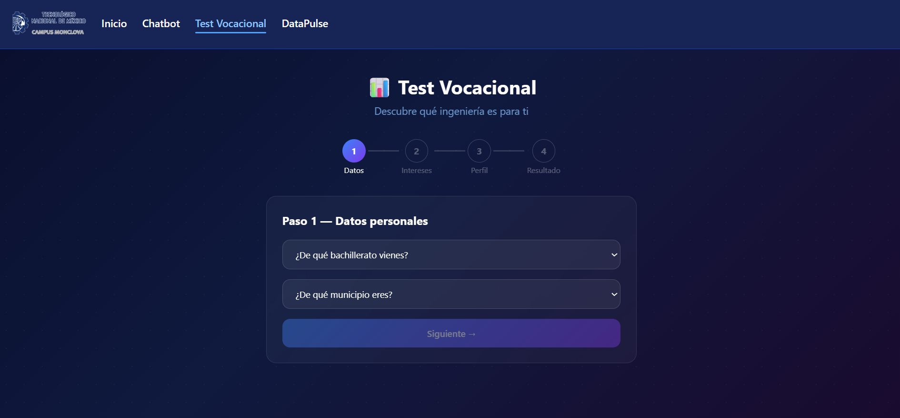
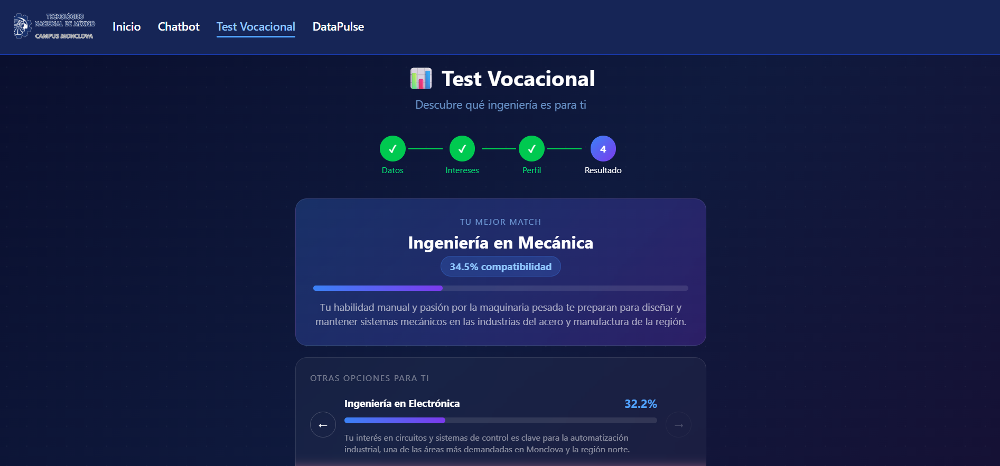
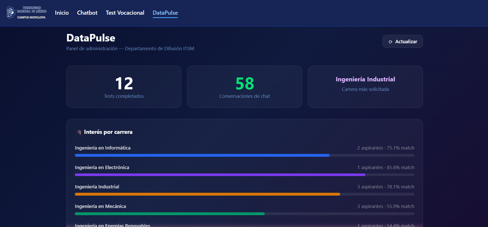

<div align="center">



# OrientaTec

**Descubre qué carrera va contigo con ayuda de inteligencia artificial.**

Hecho para futuros ingenieros del ITSM · HackaTec 2026 — Jabalí Digital


</div>

---

## ¿Qué es OrientaTec?

OrientaTec es una plataforma web de orientación vocacional impulsada por IA, desarrollada para el **Departamento de Difusión del TecNM Campus Monclova**. Ayuda a los aspirantes a descubrir qué ingeniería encaja mejor con su perfil, intereses y municipio de origen — de forma gratuita y en minutos.

---

## ✨ Funcionalidades

### 🤖 Chatbot con IA
Conversación natural con un asistente que conoce todas las carreras, becas, campus y actividades del ITSM. Respuestas en tiempo real con animación Lottie interactiva.

### 📊 Test Vocacional
Formulario de 4 pasos (datos personales → intereses → perfil → resultado) que calcula el porcentaje de compatibilidad con cada ingeniería usando vectores semánticos (pgvector). Muestra empresas donde el aspirante puede hacer residencias según su carrera.

### 📈 DataPulse
Panel de administración en tiempo real para el Departamento de Difusión. Muestra tests completados, conversaciones activas, carrera más solicitada, match promedio por ingeniería y distribución geográfica por municipio.

---

## 🖼️ Capturas de pantalla

| Inicio | Chatbot |
|--------|---------|
|  |  |

| Test Vocacional | Resultado |
|----------------|-----------|
|  |  |

| DataPulse | |
|-----------|--|
|  | |

---

## 🏗️ Arquitectura

```
OrientaTec/
├── frontend/          # React + Vite + Tailwind CSS
├── backend/           # Node.js + Express
│   ├── routes/        # chat, vocacional, dashboard
│   ├── controllers/
│   └── models/        # PostgreSQL (pgvector) + MongoDB
└── ia/                # FastAPI + Python
    ├── routers/       # chat, vocacional
    └── services/      # RAG chatbot, matcher semántico
```

**Infraestructura:**
- Servidor propio con Cloudflare Tunnel (`orientatec.sarahi-dev.com`)
- nginx como reverse proxy
- PM2 para gestión de procesos
- Docker para PostgreSQL con pgvector
- MongoDB para historial de conversaciones

---

## 🚀 Instalación local

### Requisitos
- Node.js 18+
- Python 3.11+
- PostgreSQL con extensión pgvector
- MongoDB

### Backend
```bash
cd backend
npm install
cp .env.example .env   # configurar variables
npm start
```

### IA
```bash
cd ia
python -m venv venv
source venv/bin/activate  # Windows: venv\Scripts\activate
pip install -r requirements.txt
cp .env.example .env   # agregar GEMINI_API_KEY
uvicorn main:app --host 0.0.0.0 --port 8000
```

### Frontend
```bash
cd frontend
npm install
echo "VITE_API_URL=http://localhost:4000/api" > .env.local
npm run dev
```

---

## 🎓 Carreras disponibles

| Carrera | Área |
|---------|------|
| Ingeniería en Informática | Tecnología |
| Ingeniería en Electrónica | Tecnología |
| Ingeniería Industrial | Industria |
| Ingeniería en Mecánica | Manufactura |
| Ingeniería en Energías Renovables | Sustentabilidad |
| Ingeniería en Gestión Empresarial | Negocios |

---

## 👩‍💻 Equipo

**Jabalí Digital** — HackaTec 2026, TecNM Campus Monclova

---

<div align="center">
<sub>© 2026 HackaTon TecNM Campus Monclova — Jabalí Digital</sub>
</div>
